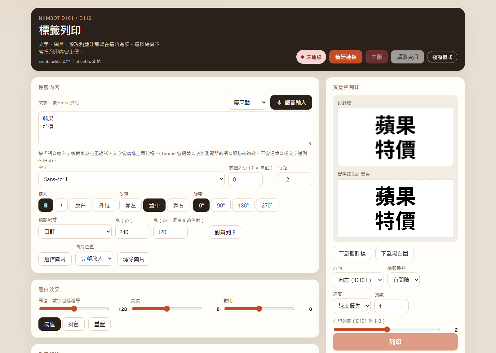
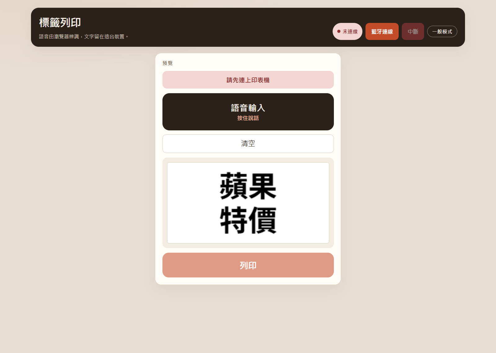
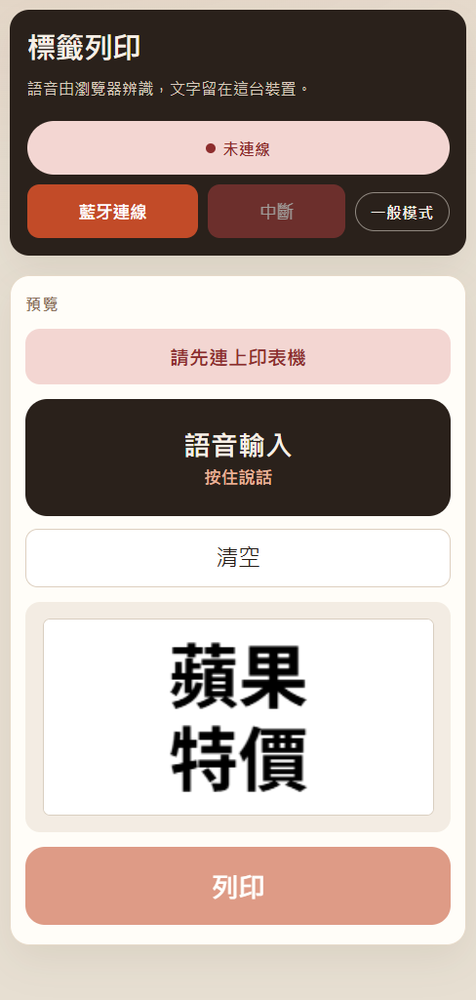

# 標籤列印

網站：https://wing9897.github.io/niimbluelib_webui/

用電腦的 Chrome 或 Edge，透過藍牙幫 Niimbot D101 / D110 印標籤。頁面在你自己的瀏覽器裡運行。標籤文字、圖片、預設和聲音檔都不會上傳到 GitHub。

連線按鈕那一列有一顆小按鈕：一般模式時寫「極簡模式」，極簡模式時寫「一般模式」，按一下就換畫面。選擇會記在這台瀏覽器裡，重新打開還是上次那個。一開始是一般模式。

## 一般模式

完整的標籤工具：文字、字型、尺寸、圖片、黑白效果、批量列印、預設，以及設計稿和實際黑白預覽。

字體會依寬度自動換行。自己按 Enter 的換行會留下來。字體大小填 0 時，會挑一個放得進標籤的大小。填了數字時，就用那個大小換行；若換完還是比標籤高，才會再縮小，避免印出去被切掉。



## 極簡模式

只留會用到的東西：連上印表機、按住說話、清空、看預覽、按列印。

字型、尺寸、深淺、方向、張數這些都不會出現。列印時用的是一般模式裡最後調好的設定；若這次還沒打開過一般模式，就用頁面原本的預設。在兩個畫面之間切換，不會把文字或設定清掉。

字體大小是例外：極簡模式一律自動換行、自動縮放，一句沒有換行的話也會排進標籤裡。一般模式填的字體大小不會被改掉，回到一般模式仍用那個數字。

還沒連上印表機時，會看到「請先連上印表機」，列印按鈕不能按。



手機寬度也是同一套畫面，按鈕比較大，方便單手按。



## 語音輸入

- 一般模式：按一下「語音輸入」開始，再按一下停止。可選廣東話、國語或 English。批量資料那一格也可以用語音。
- 極簡模式：按住「語音輸入」說話，放開就停。語言預設是廣東話；若你在一般模式改過語言，極簡模式會跟著那個選擇。

Chrome 會把聲音交給瀏覽器自己的語音服務來辨識。聲音和文字不會送到 GitHub。這個網頁沒有內建離線語音引擎，所以辨識時瀏覽器需要能連上它的語音服務。

## 資料放在哪

- 列印和藍牙只發生在這台電腦和旁邊的印表機之間。
- 按「儲存」的預設寫在這台瀏覽器裡（localStorage，鍵名 `niimbo_presets`）。換電腦或換瀏覽器就看不到。
- 一般模式或極簡模式的選擇也寫在這台瀏覽器裡（鍵名 `niimbo_ui_mode`）。
- 還沒按儲存的文字，只留在當下這個視窗。重新整理頁面會回到頁面上的預設文字。
- 程式庫放在 `lib/`，打開網頁時只讀這兩個本地檔：
  - `lib/niimbluelib.min.js`（@mmote/niimbluelib 0.0.1-alpha.29）
  - `lib/xlsx.full.min.js`（SheetJS 0.18.5，用來讀 Excel）

## 在自己電腦打開

需要 Chrome 或 Edge。印表機要在電腦旁邊。

```bash
npm install
npm run dev
```

打開 http://127.0.0.1:5173 。

若 `lib/` 裡的檔案不見了，可以再產生一次（這一步才會連網，網頁打開之後不會）：

```bash
npm run vendor
```

## 放到 GitHub Pages

倉庫裡的 `.github/workflows/pages.yml` 會在推送到 `main` 或 `master` 時，發布這些檔案：`index.html`、`main.js`、`styles.css`、`manifest.webmanifest`、`sw.js`、`icons/`、`lib/`。

`docs/` 裡的說明截圖只給這個 README 用，不會放進網站。

到 GitHub 倉庫的 Settings → Pages → Build and deployment，來源選 GitHub Actions。推送之後，用自己的 Chrome 打開那個網址即可。網址若在子目錄（`用戶名.github.io/專案名/`）也可以，腳本、圖示和清單都是相對路徑。

## 安裝到主畫面

用 Chrome 或 Edge 打開這個網頁後，可以把它裝成應用程式。網址列會出現安裝圖示；沒有的話，從瀏覽器選單選「安裝應用程式」。手機 Chrome 或 Edge 則選「加到主畫面」。裝好之後，從主畫面打開，是一個獨立視窗。

開過一次之後，沒有網路也能打開頁面。列印還是要印表機在旁邊，而且瀏覽器要能用藍牙。語音辨識則需要瀏覽器連得上它的語音服務。

用同一個 Chrome 設定檔安裝的應用程式，和瀏覽器分頁打開同一個網址，會共用已經儲存的預設和模式。

## iPhone

iPhone 的 Safari 不能使用這種網頁藍牙。加到主畫面之後也一樣連不上印表機。

## 致謝

- [niimbluelib](https://github.com/MultiMote/niimbluelib) by [MultiMote](https://github.com/MultiMote) — MIT License
- [SheetJS](https://github.com/SheetJS/sheetjs) — Apache 2.0 License

## License

MIT
